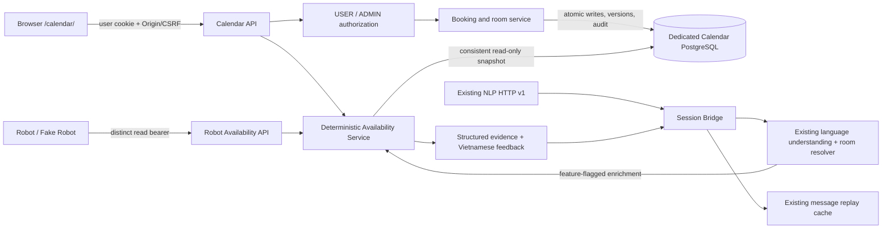
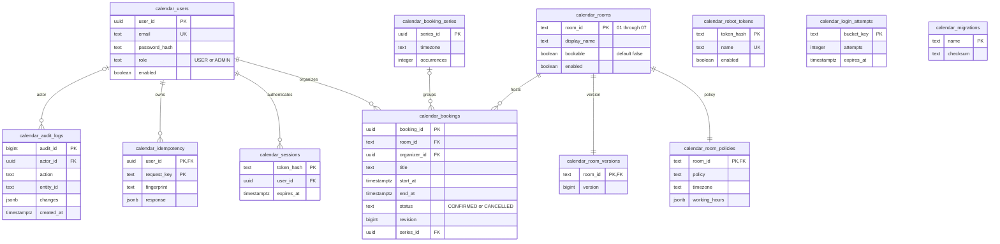

# Architecture and database

Calendar sends no ROS/Nav2 commands, dispatches no tasks and changes no lifecycle status. NLP records valid tasks through the existing pipeline. Calendar provides evidence for a separately implemented robot decision gate; no calendar data is delegated to an LLM.

## Persistence

Dedicated database, default schema `office_calendar`. Migration: `office_room_calendar/migrations/001_calendar.sql`. PostgreSQL `btree_gist` support is required; verified on PostgreSQL 17. Migrations are explicit and checksummed, never run automatically at startup. Three-second connection and five-second SQL statement timeouts. No fallback database or in-memory calendar.

Only semantic room IDs/names are seeded; no navigation poses. Availability reads policy, version and confirmed intervals in one REPEATABLE READ, READ ONLY transaction.

## Transaction guarantees

- PostgreSQL enforces `EXCLUDE USING gist (room_id WITH =, tstzrange(start_at,end_at,'[)') WITH &&) WHERE status='CONFIRMED'`. Half-open intervals allow adjacent bookings and reject overlap even if service checks are bypassed.
- Create holds an actor/request-key advisory lock and commits its replay response with the booking. Identical retries survive restart; different content returns 409. Failed creates leave no idempotency record.
- Room-version rows lock in sorted order. Expected booking revision / room version reject stale writes. Moving a booking versions both rooms.
- Booking, audit and version updates commit together. Weekly create is atomic; one occurrence conflict rolls back the whole series.
- Out-of-band SQL is not a supported booking/policy write interface: it would bypass service version/audit semantics.
- Evidence reserves no future slot. Version changes invalidate old evidence even within its short TTL.

## Credentials and website

Argon2id passwords are provisioned by CLI. Random session token digests persist for 12 hours; current enabled/role state is checked per request. Cookies are HttpOnly, SameSite=Strict, scoped to `/v1/calendar`, Secure on HTTPS. Writes check exact Origin and session-bound HMAC CSRF token; login checks Origin/JSON. Persistent login limits: eight attempts/email and 100/network per 15 minutes; password verification concurrency is bounded.

Robot token digests are stored separately and authenticate only the read API. Browser code contains no backend bearer, robot secret or localStorage credential. DOM text rendering protects meeting/room titles. Local scripts are enforced by CSP; generated FullCalendar layout needs inline styles. Runtime errors return safe messages without database credentials or raw internal errors.
